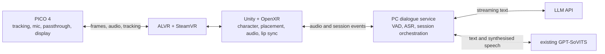

# Architecture

Derived from the project plan. Where this document and the plan disagree, the
plan wins and this file is the bug.

## Goal (v1)

Put on a PICO 4, manually place **祀** in the passthrough view of the real room,
and hold a spoken Chinese conversation without pressing any button. The character
stands, blinks, and lip-syncs to the audio that is actually being played.

## Frozen decisions

| Decision | Choice |
|---|---|
| Display path | ALVR mainline stable, matched versions at both ends |
| PC OpenXR runtime | SteamVR |
| Client | Unity 6.3 LTS, **Built-in render pipeline** (URP deliberately not installed), built as Windows x64 |
| Character | user-supplied `祀.pmx`, one fixed character |
| Dialogue | OpenAI-compatible streaming API; URL, model and key configured locally |
| Voice | reuse the existing GPT-SoVITS + 小酒狐 voice |
| Memory | current session only; no chat restored after exit |
| Character pipeline | offline PMX reader (`tools/pmx/`) → MGFR binary → runtime loader; no MMD importer and no PMX parsing at runtime |

Deferred to a later version: the small emotion model, motion authoring, multiple
characters, visual understanding, depth measurement, furniture occlusion.

## Module map

## The PC / headset split

This boundary is easy to get wrong, so it is stated explicitly:

- The **Windows Unity app** renders through the **SteamVR OpenXR runtime**.
- **Passthrough is composited by the ALVR client on the headset**, not by the PC
  app. The PC app never receives the camera image.
- Therefore: no PICO Android SDK in the Windows client, and **no assumption that
  SteamVR exposes headset cameras or room depth to a PC application.**

The consequence for chroma key: the Unity app draws a *stable solid background*
and ALVR keys it out. That is a colour key, not an alpha channel. Anything that
perturbs the background colour — post-processing, colour conversion, anti-aliasing
— or that happens to match the key colour (hair strands, eyelashes, cloth, UI)
will be visibly wrong. This is checked with both eyes on the device.

## Voice path

**Status, so this section is not read as built.** Measured on this machine on
2026-10-18:

- **Real, and exercised end to end:** GPT-SoVITS synthesis plays back through the
  Unity client with lip sync. SenseVoice INT8 transcribes local Chinese and
  Japanese audio on the CPU, and Silero VAD segments that audio — speech start
  *and* speech end both fire, so an utterance can actually close.
- **Still simulated:** the **LLM**. This project has no LLM address, model or key
  of its own, so the reply text is a stub. Typed text reaching real GPT-SoVITS is
  real speech, but the turn is not a real AI conversation and is not called one.
- **Not built:** there is **no AEC module in v1**. The paragraph below describes
  the intended design, not the current state, and barge-in during playback is
  unverified (constraint #8). Muting the microphone while the character speaks
  would not change that, and is not a substitute for it.

- Unity captures the headset microphone and feeds the audio that is actually
  playing into **WebRTC APM / AEC3** so the character does not trigger itself.
  Echo cancellation runs on the audio thread; that thread does no networking and
  no model inference.
- The dialogue service runs separately (Python + FastAPI) and exchanges audio,
  text and status with Unity over a **loopback WebSocket**. The API key is held by
  the service, never by the client.
- Recognition is **sherpa-onnx + SenseVoice INT8 on CPU**, with Silero VAD
  segmenting utterances. v1 recognises per sentence; it does not run continuous
  video analysis.
- LLM output is split into **short sentences** and sent to GPT-SoVITS' native
  `/tts` endpoint. **One synthesis request runs at a time.**
- Lip sync is driven by the **audio actually being played**, smoothed, using
  volume open/close in v1. Accurate five-vowel sync is a later version.

## Placement

Placement, rotation, scale and floor calibration are driven by the controller.
Position is relative to the current tracking space: re-centring or a tracking-space
change requires re-calibration.

## Scope boundary for v1

In: passthrough placement, a basic standing pose, blinking, lip sync, and
current-session dialogue.

Out: emotion or motion commands (v1 accepts none, so v2 has a clean place to add a
separate character-control entry point), multiple characters, depth occlusion.
