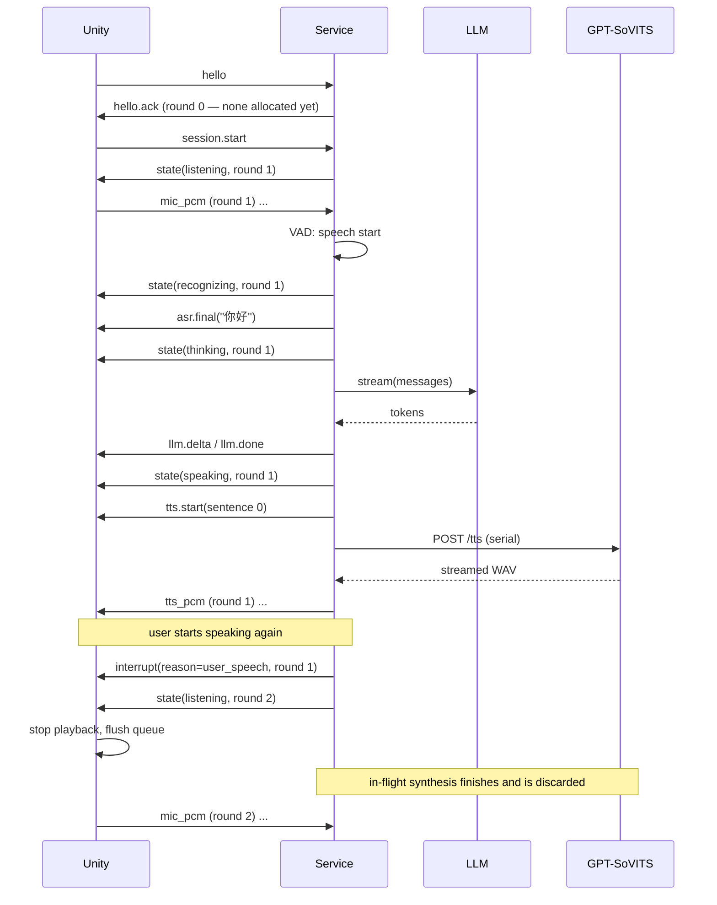

# Wire protocol — Unity client ↔ dialogue service

Version `1`. Implemented by `dialogue-service/app/protocol.py`; this document and
that module must be changed together.

## Transport

A single WebSocket over loopback, default `ws://127.0.0.1:8765/ws`.

- **Text frames** carry JSON control messages.
- **Binary frames** carry PCM audio.

Two frame kinds on one socket means ordering between control and audio is
preserved by the transport itself, which is what makes round-id-based discarding
reliable.

## Binary audio frame

Little-endian, 24-byte header, then payload.

| Offset | Size | Type | Field | Notes |
|---|---|---|---|---|
| 0 | 1 | uint8 | `version` | `1` |
| 1 | 1 | uint8 | `kind` | `1` = mic PCM, `2` = TTS PCM |
| 2 | 2 | uint16 | `flags` | reserved, must be `0` |
| 4 | 4 | uint32 | `round` | round id |
| 8 | 8 | uint64 | `seq` | per `(kind, round)`, starts at `0` |
| 16 | 4 | uint32 | `sample_rate` | Hz |
| 20 | 2 | uint16 | `channels` | |
| 22 | 2 | uint16 | `frame_ms` | informational |
| 24 | … | int16[] | `payload` | interleaved PCM, **S16LE** |

`struct` format: `<BBHIQIHH`.

v1 is S16LE only. A different sample format is a protocol version change, not a
new field.

`seq` lets the receiver detect gaps and reordering; it is per kind and per round,
and resets when the round changes.

## Control messages

Common envelope: `v` (int, `1`), `type` (string), `ts` (float, unix seconds).
`round` is present wherever a message belongs to a turn.

### Client → service

| `type` | Fields | Meaning |
|---|---|---|
| `hello` | `clientVersion`, `audio{micSampleRate, micChannels}`, `capabilities[]` | First message. Nothing else is accepted before it. |
| `session.start` | — | Begin a conversation session. Service replies `state` with the first round id. |
| `session.end` | — | End the session and clear all state. |
| `playback.started` | `round`, `sentenceIndex` | Playback of a TTS sentence actually began. |
| `playback.finished` | `round`, `sentenceIndex`, `reason` | `completed` \| `interrupted` \| `error`. |
| `interrupt` | `round`, `source` | Client-side barge-in (`source: "client"`), e.g. a controller press. |
| `text.input` | `text` | Typed text in place of speech. Runs the same round a recognition result would: ASR is skipped, the LLM is called and TTS streams back, and an `interrupt` stops it like any other turn. The service allocates the round, so the client sends no `round`. A missing or blank `text` is answered with a recoverable `error` (`BAD_FRAME`) and nothing else happens. |
| `ping` | `t` | Liveness. |

### Service → client

| `type` | Fields | Meaning |
|---|---|---|
| `hello.ack` | `serverVersion`, `audio{ttsSampleRate, ttsChannels, sampleFormat:"s16le", container:"raw"}`, `engines{}`, `limits{maxConcurrentTts}`, `round` | Handshake reply, sent with `round: 0` — no round exists yet. `engines` reports which engines are actually live, so the client can show a degraded state. `ttsSampleRate` is **`0` when it is not yet known** (the GPT-SoVITS adapter only learns it from a real response); the authoritative value is the one in each `tts.start`. |
| `state` | `round`, `state`, `detail` | State machine transition. |
| `asr.partial` | `round`, `text` | Optional interim recognition. |
| `asr.final` | `round`, `text` | Final recognition for the round. |
| `llm.delta` | `round`, `text` | Incremental assistant text. |
| `llm.done` | `round`, `finishReason` | Assistant text complete. |
| `tts.start` | `round`, `sentenceIndex`, `text`, `audio{…}` | A sentence is about to be sent as binary frames. |
| `tts.end` | `round`, `sentenceIndex`, `reason` | `completed` \| `interrupted` \| `error`. |
| `interrupt` | `round`, `reason` | `user_speech` \| `client_request` \| `session_end`. |
| `error` | `round`, `code`, `message`, `recoverable` | See codes below. |
| `pong` | `t` | Liveness reply. |

### States

`idle` → `listening` → `recognizing` → `thinking` → `speaking` → back to
`listening` (or `idle`). `error` is reachable from any state.

## Rounds

- The **service is authoritative** on round ids. They are integers, allocated
  monotonically from `1` per session.
- A round is allocated by `session.start`, and again at every speech onset. It
  covers one user utterance and the assistant reply to it.
- A round is **finished** once its reply has been fully delivered. A speech onset
  while the current round is unfinished is an interruption; one after it has
  finished is simply the next turn.
- Microphone frames echo **the client's last-known round**. The service attributes
  incoming mic audio to its own current round regardless and logs a mismatch at
  debug level. This keeps the client free of round-allocation logic.

## Interruption

Playback and inference are separate concerns (constraint #7) and the protocol
reflects that:

- On detecting the user speaking again, the service emits `interrupt` with
  `reason: "user_speech"`, allocates a **new** round, and returns to `listening`.
- The client's obligation on `interrupt` is immediate and local: **stop playback,
  flush queued audio.** It is not asked to cancel anything on the server.
- The service, in parallel, cancels the LLM stream and marks the TTS generation
  epoch stale. GPT-SoVITS has no cancel endpoint, so the in-flight synthesis runs
  to completion and its output is **discarded**.
- **The client must drop any `tts_pcm` frame whose `round` is not the current
  round.** This is the mechanism that makes late audio harmless; it is not an
  optimisation.

## TTS audio contract

- The service sends **raw PCM only**. It parses the WAV container returned by
  GPT-SoVITS, strips the header, and forwards samples. A partially written WAV is
  never handed to the client as if it were complete.
- Sample rate and channel count are read from the **actual response** and declared
  in both `tts.start` and each binary frame header. They are not hardcoded, and the
  client must not assume 32 kHz or any other value.

## Versioning and errors

Both the binary `version` byte and the JSON `v` field must match. On mismatch the
service emits `error` with code `PROTOCOL_VERSION` and closes.

| Code | Recoverable | Meaning |
|---|---|---|
| `PROTOCOL_VERSION` | no | Version mismatch. |
| `BAD_FRAME` | yes | Malformed binary frame; the frame is dropped. |
| `ROUND_STALE` | yes | Message for a round that is no longer current. |
| `ENGINE_UNAVAILABLE` | yes | A configured engine failed to load. |
| `ASR_FAILED` | yes | Recognition error; the round is abandoned. |
| `LLM_UNAVAILABLE` | yes | LLM call failed. Text may be partially delivered. |
| `TTS_UNAVAILABLE` | yes | Synthesis failed. **The text reply is still delivered.** |
| `INTERNAL` | no | Unexpected service error. |

Constraint #7's "TTS failure keeps the text reply" is enforced by the
`TTS_UNAVAILABLE` path: `llm.delta` / `llm.done` have already been sent by the
time synthesis runs, so a TTS failure never removes the text.

## A full turn, with barge-in

